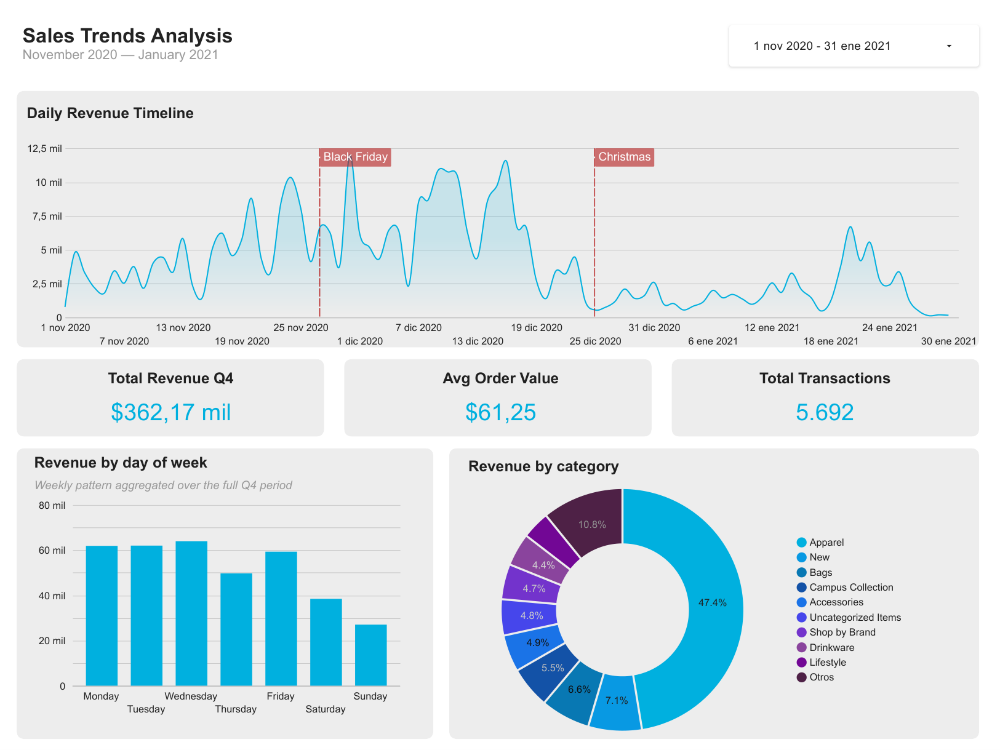
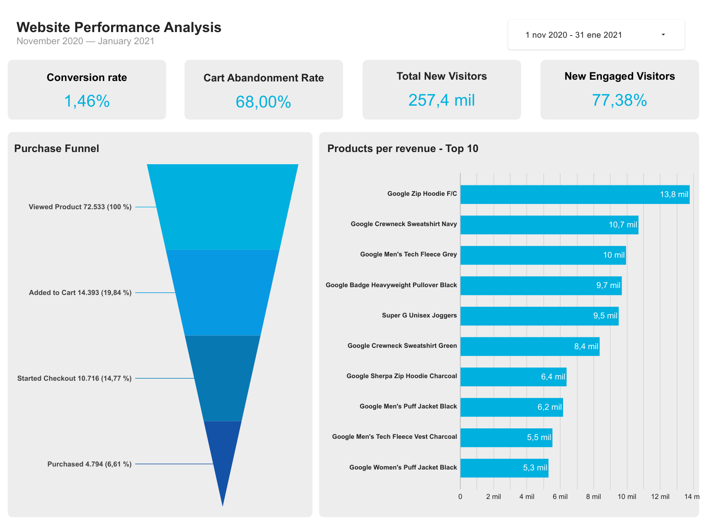
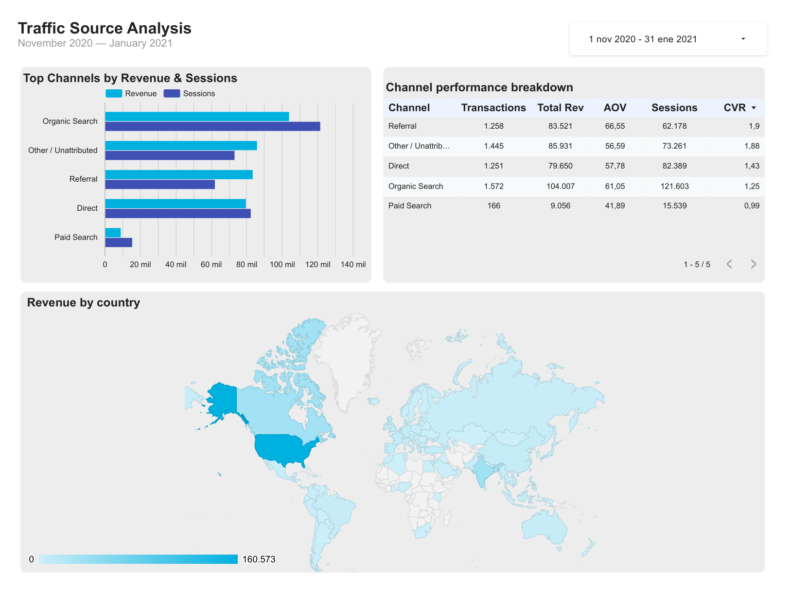
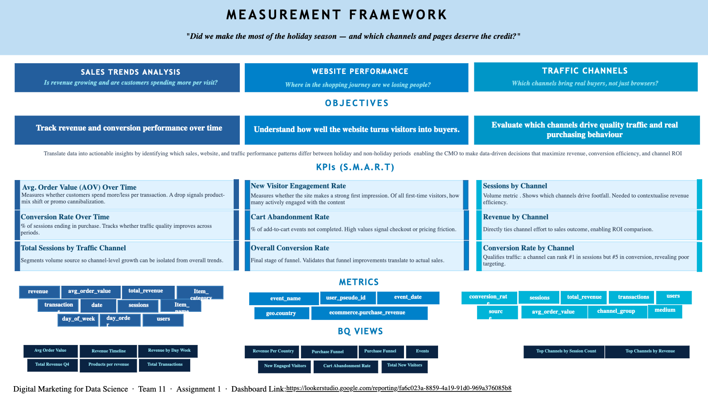

# Google Store CMO Dashboard: Did We Make the Most of the Holiday Season?

> *"Did we make the most of the holiday season, and which channels and pages deserve the credit?"*

This is a group project (**Team 11**) for **Digital Marketing & Data Science** at Erasmus University Rotterdam. We acted as analysts for the **Google Merchandise Store**, Google's online shop. We wrote **SQL views in Google BigQuery** on its Google Analytics 4 (GA4) data and built a **3-page CMO dashboard in Looker Studio** to answer three questions:

1. **Sales:** Is revenue growing, and are customers spending more per visit?
2. **Website:** Where in the shopping journey are we losing people?
3. **Channels:** Which channels bring real buyers, not just browsers?

🔗 **[Live dashboard (Looker Studio)](https://lookerstudio.google.com/reporting/fa6c023a-8859-4a19-91d0-969a376085b8)** · 📄 [PDF version](docs/cmo_dashboard.pdf)

## Key findings (1 Nov 2020 – 31 Jan 2021)

| Revenue | Transactions | Avg. order value* | Conversion rate |
|---|---|---|---|
| **$362,170** | **5,692** | **$61.25** | **1.46%** |

*\*Average of daily order values. Total revenue ÷ total transactions gives $63.63.*

**Sales**
- **The holidays drove the business.** November and December brought **84% of all revenue**. January fell 64% below December.
- **The best day was Cyber Monday** (30 Nov, ~$12k). Sales stayed high until mid-December and dropped sharply before Christmas, likely after the last shipping dates.
- **Apparel is almost half of all revenue (47%).** The top seller was the **Google Zip Hoodie** ($13.8k), and almost all of the top 10 products are hoodies, sweatshirts, fleeces and jackets: winter gifts.
- **Weekdays beat weekends.** Monday to Wednesday bring about $62–64k each. Sunday brings only $27k.

**Website**
- **Most visitors leave after looking.** Of the shoppers who viewed a product, only **19.8% added it to their cart** and **6.6% bought it**.
- **68% of carts are abandoned**, which points to friction in checkout, shipping costs or pricing.
- **The site attracts new people.** We counted 257.4k new visitors, and 77% of them engaged with the site.

**Channels**

| Channel | Revenue | Sessions | Transactions |
|---|---|---|---|
| Organic Search | $104,007 | 121,603 | 1,572 |
| Other / Unattributed | $85,931 | 73,261 | 1,445 |
| Referral | $83,521 | 62,178 | 1,258 |
| Direct | $79,650 | 82,389 | 1,251 |
| Paid Search | $9,056 | 15,539 | 166 |

- **Organic search brings the most traffic and revenue**, but converts below average.
- **Referrals convert best.** Visitors sent by other sites arrive ready to buy and spend the most per order.
- **Paid search underperforms.** It has the lowest conversion and the smallest orders, so it should be reviewed before the next holiday season.
- **The US brings 44% of revenue** ($160.6k), followed by India and Canada.

## The dashboard

<p align="center"></p>
<p align="center"></p>
<p align="center"></p>

## Measurement framework

We started from the CMO's question and linked each objective to SMART KPIs, the GA4 fields behind them, and the BigQuery views that feed the dashboard.

<p align="center"></p>

## SQL views

| View | KPI | File |
|---|---|---|
| Daily performance | Users, sessions and engagement per day | [`01_daily_performance.sql`](sql/01_daily_performance.sql) |
| Daily revenue | Revenue, transactions, average order value | [`02_daily_revenue.sql`](sql/02_daily_revenue.sql) |
| Conversion rate | Purchases per session, per day | [`03_conversion_rate.sql`](sql/03_conversion_rate.sql) |
| Traffic channels | Users and sessions per medium and source | [`04_traffic_channels.sql`](sql/04_traffic_channels.sql) |
| Revenue by source | Which channels actually drive sales | [`05_revenue_by_source.sql`](sql/05_revenue_by_source.sql) |
| Device breakdown | Desktop vs mobile vs tablet | [`06_device_breakdown.sql`](sql/06_device_breakdown.sql) |
| Geography | Users and revenue by country and city | [`07_geography.sql`](sql/07_geography.sql) |
| Purchase funnel | Unique users: view → cart → checkout → purchase | [`08_purchase_funnel.sql`](sql/08_purchase_funnel.sql) |
| Time patterns | Performance by day of the week | [`09_time_patterns.sql`](sql/09_time_patterns.sql) |
| Channel performance | Revenue, sessions and conversion per channel group | [`10_channel_performance.sql`](sql/10_channel_performance.sql) |
| Top products | Top 10 products by revenue | [`11_top_products.sql`](sql/11_top_products.sql) |
| Revenue by category | Revenue share per product category | [`12_revenue_by_category.sql`](sql/12_revenue_by_category.sql) |

Example: the purchase funnel, counting unique users per step.

```sql
WITH daily AS (
  SELECT event_date,
    COUNT(DISTINCT IF(event_name = 'view_item',      user_pseudo_id, NULL)) AS viewed_product,
    COUNT(DISTINCT IF(event_name = 'add_to_cart',    user_pseudo_id, NULL)) AS added_to_cart,
    COUNT(DISTINCT IF(event_name = 'begin_checkout', user_pseudo_id, NULL)) AS started_checkout,
    COUNT(DISTINCT IF(event_name = 'purchase',       user_pseudo_id, NULL)) AS purchased
  FROM `bigquery-public-data.ga4_obfuscated_sample_ecommerce.events_*`
  GROUP BY event_date
)
SELECT SUM(viewed_product), SUM(added_to_cart), SUM(started_checkout), SUM(purchased)
FROM daily;
```

The results of every view are saved as CSV in [`results/`](results/). Re-running them on the public dataset reproduces the dashboard's revenue, transactions, daily timeline, funnel, channels, products, categories and countries exactly.

## What I'd improve

- **Engagement rate.** View 1 divides `user_engagement` events by sessions. One session can contain several engagement events, so the value is closer to *engagement events per 100 sessions* than to a percentage. GA4's official engagement rate uses the `session_engaged` parameter.
- **Ratios in Looker Studio.** Some KPI cards (average order value, conversion rate, channel CVR) average the daily values instead of dividing totals. Dividing totals is more robust, e.g. average order value $63.63 instead of $61.25.
- **Obfuscated data.** Google anonymised parts of this sample, so a large share of traffic shows as `(data deleted)` or `<Other>`, grouped here as *Other / Unattributed*.

## Repository structure

```
├── sql/              BigQuery views behind the dashboard
├── results/          query results (CSV)
├── figures/          dashboard pages
├── docs/             measurement framework and dashboard PDF
└── run_queries.py    runs every view in sql/ and saves the results
```

## Reproduce

The data is Google's public **[GA4 sample e-commerce dataset](https://developers.google.com/analytics/bigquery/web-ecommerce-demo-dataset)** (`bigquery-public-data.ga4_obfuscated_sample_ecommerce`), free to query in the BigQuery sandbox.

```bash
pip install google-cloud-bigquery pydata-google-auth db-dtypes pandas
GCP_PROJECT=your-project-id python run_queries.py
```

All views use the full public table name, so they run in any Google Cloud project.

## Tools

SQL · Google BigQuery · Google Analytics 4 · Looker Studio · Python (pandas)
